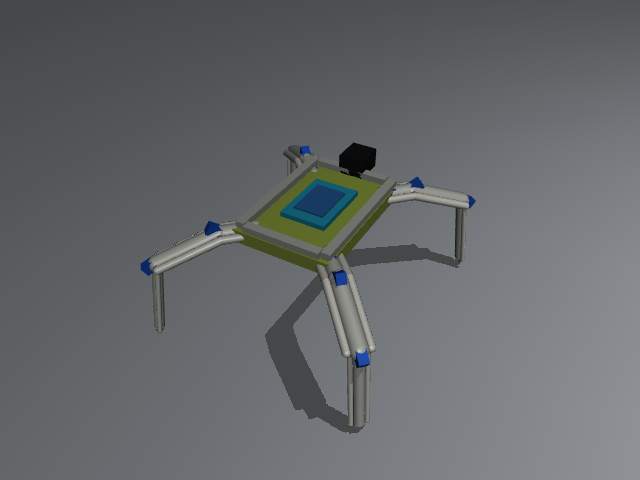

# Midori MuJoCo Work

## Purpose

This folder contains the current MuJoCo prototype for Midori, a four-legged spider-style robot intended to use twelve servo joints. The simulator is a place to test joint naming, control ideas, and logging before connecting the mobile model and ESP32. It is not yet a dimensionally accurate digital twin of the printed robot.

## Run

Run commands from the repository root (`D:\midori`):

```powershell
uv sync
uv run python mujoco/control_test.py
```

The program opens a MuJoCo viewer and a separate control window. Close either window to end the session. Each run creates a CSV log under `mujoco/logs/`.

## Front camera

`hello.xml` includes a small camera module mounted at the front of the chassis. The MuJoCo camera is named `front_camera`, points forward along the robot's X axis, and tilts down slightly toward the floor. The camera shell is represented on the chassis as a small dark box.

Capture a single PNG from the standing pose:

```powershell
uv run python mujoco/camera.py --output mujoco/camera_frames/front.png
```

The default output is a 320 by 240 image in `mujoco/camera_frames/`; this folder is ignored by Git. Increase the output size with `--width` and `--height` up to the MuJoCo offscreen framebuffer limit. The capture script saves one image per run; it does not stream images or create a sequence automatically.

For use inside a future perception loop, import `RobotCamera` and call `capture(data)` after advancing the MuJoCo simulation:

```python
import sys
sys.path.insert(0, "mujoco")
from camera import RobotCamera

camera = RobotCamera(model, width=320, height=240)
rgb_frame = camera.capture(data)  # NumPy uint8 array, shape (240, 320, 3)
camera.close()
```

This is a virtual simulation camera. A physical camera module, its connection to the phone or ESP32, and image transport to the planned multimodal model remain future hardware/software work.

## Controls

The Drive panel uses hold-to-move controls:

- Hold Forward or Backward to move; release the button to stop the gait.
- Hold Turn Left or Turn Right to rotate; release the button to stop turning.
- The arrow keys and WASD do the same while the Tkinter control window has keyboard focus. Releasing the key stops that motion.
- Stop ends the gait and holds the current slider targets.
- Stop and return to standing pose stops the gait and sets the joint targets to the model's standing pose.

The standing pose splays the femurs away from the chassis and points the tibias down to the floor, giving the robot a low, crab-like stance. The default viewer camera is set to show the legs from above and from one side.

The gait is a quicker continuous crawl sequence. It assigns a different phase to each leg so only one foot lifts at a time while the other three support the body. Forward/backward use a 50 mm stance/swing path; turns use a wider 90 mm arc to make yaw changes visible. Foot lift is about 22 mm and the nominal cycle is 1.05 Hz. Inverse kinematics converts foot targets to coxa, femur, and tibia angles. Direction buttons and keys keep hold-to-move behavior: pressing starts the selected gait, and releasing returns control to the standing pose. Left and right use opposite stance sweeps. Servo housings, horn discs, and decorative bracket rails are visual-only geoms with contact disabled; the frame, primary links, feet, and floor provide the physical contacts.

This remains an initial simulator gait, not a calibrated physical-robot controller. The model uses estimated dimensions and contact properties. It can still slide, tip, or walk imperfectly; tune it against the exact printed frame before transferring commands to hardware. Use the sliders for individual joint inspection.

## Automatic motion tracking

The controller records at most 10 rows per real-time second. Sampling uses a wall clock, so speeding up the MuJoCo viewer does not increase the recording rate. Each CSV contains up to 5,000 data rows; longer runs automatically continue in the next numbered CSV part. For example: `mujoco/logs/motion_20261026_120000_123456_part001.csv`.

Each CSV contains:

- A local recording timestamp for each sample.
- Simulation time and active movement mode.
- Chassis position in metres and orientation as a quaternion.
- Chassis linear and angular velocity.
- Target angle, simulated joint angle, and simulated joint velocity for each of the 12 joints.
- World-space XYZ position of each foot.

The `target_*` columns are commands sent to the simulator. The `actual_*` columns are the MuJoCo simulated joint positions. These are not physical servo encoder readings. When the ESP32 link is implemented, real servo telemetry and timestamps should be added as separate fields so simulated commands can be compared with measured hardware motion.

Logs are written and flushed while the simulation is running, so a normally closed run leaves a readable CSV file. The `logs/` folder is ignored by Git to avoid committing large run histories.

## Current model

`hello.xml` contains a free chassis and four three-joint legs. The control names are retained for compatibility with the first slider controller; their anatomical meaning in this model is:

| Existing control name | Model role |
| --- | --- |
| `*_hip_abduction` | Coxa yaw about the vertical axis |
| `*_hip_pitch` | Femur pitch |
| `*_knee_pitch` | Tibia/knee pitch |

The model uses gravity, contact with a ground plane, and position actuators for the 12 joints. The visible geometry has been revised using the supplied CAD screenshot as a visual reference: a rectangular center frame with a raised perimeter, a blue electronics panel, compact inset servo details, small horn discs, and light printed-style brackets and link rails. The lower links taper visually and end in small pointed tips; there are no spherical wheel-like feet. Servo cases, horns, and decorative rails are visual-only so they do not collide with and jam the moving links. The frame, primary links, pointed tips, and floor provide the physical contacts.

The screenshot is a perspective image rather than a dimensioned CAD export. The XML therefore remains a visual/mechanical approximation: the original STL meshes, exact servo models, pivot coordinates, frame dimensions, link lengths, masses, center of mass, and joint stops have not been recovered from the image. The control-facing joint and actuator names remain unchanged. Do not interpret the visual update as measured mechanical calibration.

### Assumptions that still need measurements

The product is a printed-parts kit sold without servos. The seller identifies two versions for different servo-horn sizes. The exact servo model, STL dimensions, mass, and calibrated joint ranges are not specified in the model. The current approximate values include a 130 mm by 90 mm chassis footprint, a 30 mm coxa, approximately 57 mm femur, and approximately 71 mm tibia. These are modeling placeholders, not verified product specifications.

Before treating the simulation as a twin, measure the actual frame and record:

1. Chassis length, width, thickness, and assembled height.
2. Pivot-to-pivot lengths for the coxa, femur, and tibia.
3. Servo make/model and whether the printed parts fit original-size or larger clone horns.
4. Servo neutral positions, rotation directions, hard stops, and safe operating limits.
5. Printed frame mass, total assembled mass, and approximate centre of mass.

See [robot_spec.md](robot_spec.md) for the measurement checklist.

## Project direction: multimodal model and robot control

The intended later project is a multimodal language model, approximately 150 million parameters, pretrained from scratch and ultimately run on a mobile phone connected to the robot's ESP32. The proposed sequence is:

1. Build a custom training dataset and tokenizer/representation suitable for the chosen text, audio, and image inputs.
2. Pretrain from scratch using an estimated mixture of about 5 billion tokens. Planned data includes voice notes and commands, images, servo readings, and action sequences. Examples will need time alignment so a command, observed scene, robot state, and resulting action can be learned together.
3. Supervised fine-tune the pretrained model for instruction following and grounded robot tasks.
4. Explore reinforcement learning after a reliable simulator and evaluation tasks exist.
5. Investigate physics-informed neural networks or other physics-aware methods for predicting dynamics and constraining action selection.
6. Build a phone-to-ESP32 interface with an explicit command protocol, telemetry, and limits on allowed servo commands.

These are plans, not implemented features. There is currently no multimodal model, custom dataset, pretraining run, SFT or RL pipeline, physics-informed network, mobile inference app, or ESP32 communication code in this folder. The 150M parameter size and 5B token estimate are preliminary project targets; architecture, data rights and quality, compute, evaluation, and deployment performance still need to be worked out.

## Current simulator preview

The screenshot below shows the CAD-inspired model in its standing pose. Blue insets represent approximate servo locations, the small purple discs represent approximate horns, and the pale link rails represent the printed brackets/links. The narrow, light-colored tips replace the earlier round feet. Colors and shapes are visual aids, not verified surface geometry.



## Suggested next simulator work

1. Replace the placeholder links with measured dimensions or meshes from the exact printed-parts version.
2. Calibrate each simulated joint's zero direction and range against the assembled robot.
3. Tune or replace the initial gait with foot-space inverse kinematics and measured servo timing.
4. Compare each motion log with real ESP32 telemetry after that interface exists.
5. Define repeatable simulation and hardware evaluation tasks before using reinforcement learning.
